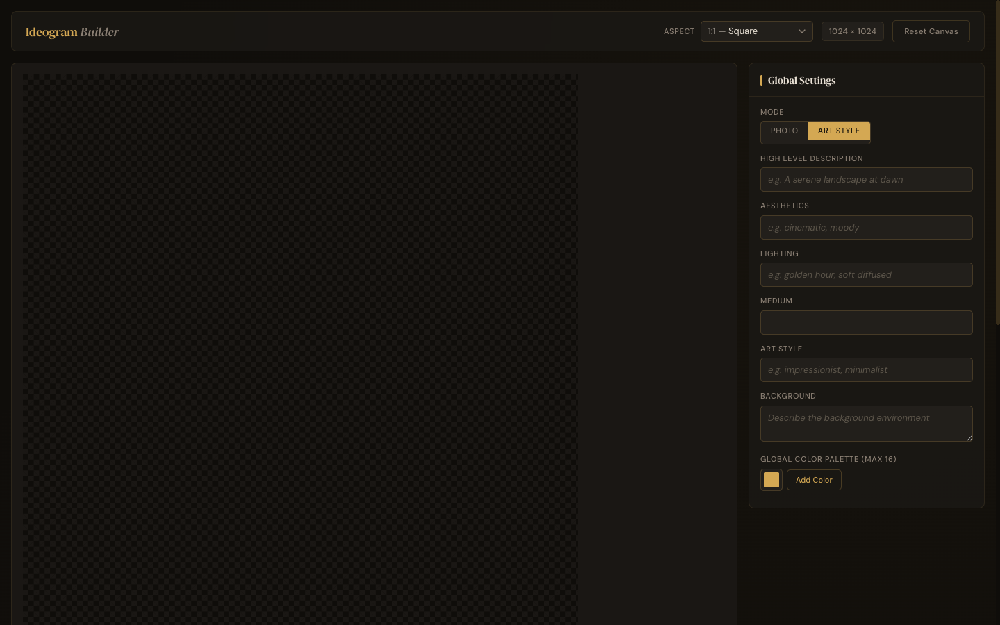
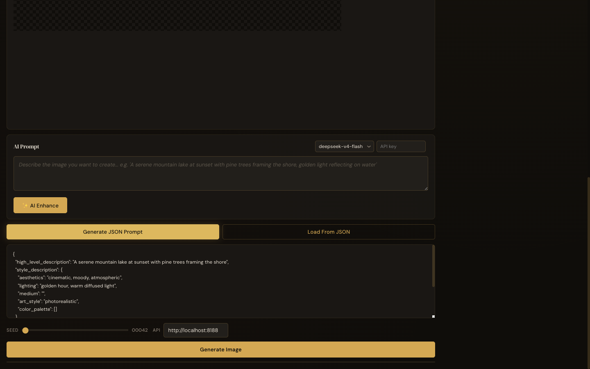

# Ideogram Builder

Visual prompt builder for [Ideogram4](https://ideogram.ai/) and [MOSS-Image](https://huggingface.co/OpenMOSS-Team/MOSS-Image-SFT) JSON image generation. Canvas-based bounding box editor with color palettes, RunPod/Modal backends, and PNG metadata import.




## Features

- **Canvas editor** — draw, drag, and resize boxes within the canvas; Escape cancels an unfinished edit
- **Color palettes** — add/remove swatches, auto-apply to selected boxes
- **Layer panel** — reorder, hide/show, and lock boxes; arrow keys select layers and Alt+arrows reorder them
- **Session restore** — preserve custom canvas dimensions, layer colors, locks, visibility, selection, saved reference images and opacity, and boxes retained in MOSS caption mode
- **Collection variables** — saved values work across collapsed cards and batch generation, with JSON-safe substitution and checks for unfilled variables
- **JSON output** — live-generated Ideogram-compatible JSON prompt
- **Prompt drafts** — manual edits survive canvas changes and reloads; Cmd/Ctrl+Enter applies, and Generate applies the draft before queueing
- **Queue recovery** — visible errors and retry with the saved prompt and settings; progress updates preserve keyboard focus, and canceled results cannot replace the canvas
- **Collection backups** — import/export preserves saved variables and local image references; invalid files and failed imports leave existing collections intact
- **Collection editing** — arrow keys switch collections; prompt edits keep their draft and cursor while you work, Cmd/Ctrl+Enter saves, and Escape cancels edits or renames
- **PNG import** — drag-drop existing images, extract metadata and bounding boxes
- **Vision / Image-to-JSON** — upload a reference image and auto-generate a prompt via vision LLM
- **Two models** — Ideogram 4 and MOSS-Image workspaces share the canvas/boxes/palette; MOSS adds layout (centralized yxyx) and caption prompt formats, per-box tags and character boxes
- **RunPod / Modal generation** — send prompts to a RunPod serverless endpoint or a Modal app; MOSS jobs route to their own endpoint/worker automatically
- **AI prompt enhancer** — refine prompts via DeepSeek, Google, OpenRouter, or Mimo
- **Gallery** — searchable image history saved on disk, model filters, cached previews, and original image downloads
- **Settings** — mode toggle (freeform / grid), aspect ratio presets, box form fields

## Quick Start

```bash
python3 server.py
```

Opens at `http://localhost:8080`. Server auto-loads LLM credentials from `~/.config/llm-credentials.json` (see `config.example.json` for every key, including `runpod.endpoints.moss`, `modal.lora_volume` and `huggingface` for private LoRA uploads).

## Tests

```bash
NODE_OPTIONS=--no-experimental-webstorage npm test          # frontend (Node 26 needs the flag)
uv run --with pytest --with requests --with websocket-client pytest runpod        # handler
uv run --with pytest --with numpy --with pillow --with requests pytest test_server_lora.py test_gallery_thumbnails.py  # local server
```

## Tech Stack

Vanilla JS, no build tools. ES modules via `<script type="module">`.

## Project Structure

```
/                   — Frontend (vanilla JS app)
/runpod/            — RunPod Serverless backend (Docker image + handler)
/docs/              — Prompting guide and architecture plans
```

## Backends

RunPod and Modal each host an Ideogram-4 and a MOSS-Image worker (separate Docker images, one shared handler). See [`runpod/README.md`](runpod/README.md) for endpoint setup, credentials keys and the local LoRA upload flow (file → Modal volume and/or private HF repo, downloaded on workers with `HF_TOKEN`).

## License

MIT
