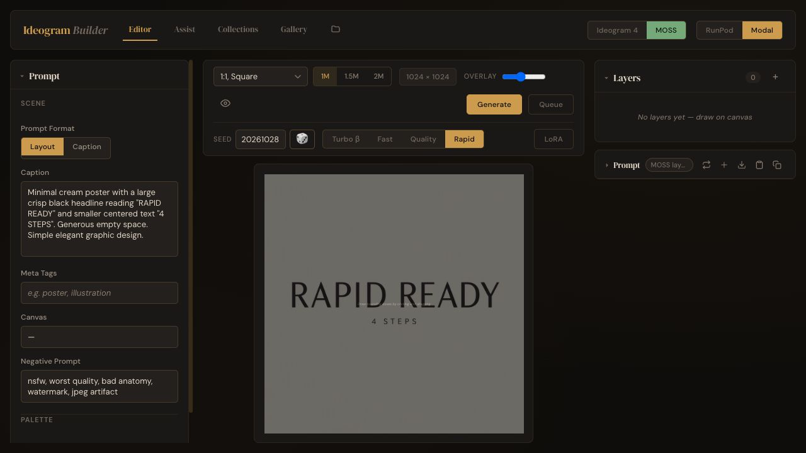

# Permanent Rapid release

2026-10-29: production now supports Rapid through 4 MP with 4/6/8 steps; see the [high-resolution release](2026-10-29-rapid-hires.md). The original 1 MP profile documented below is retained for rollback.

The user reviewed the image comparison and explicitly approved permanent availability on 2026-10-28: “rapid seems really good we can add it permanently.” This is a release decision based on user visual acceptance and the completed [108-image benchmark](rapid-benchmark-2026-10-28/README.md). It does not claim that formal human CER, annotated IoU or whole-suite usable-image-rate scores were collected.

## Release configuration

- Production app: `yofarcorp/ideogram-builder`.
- Profile: `rapid-auto-int8-cu128`, promoted to `validated`, with `validated_presets["Rapid"] = 1`.
- Permanent GUI label: **Rapid**. Four steps, CFG 1, euler/simple, `rapid4` adapter, at most 1,048,576 pixels. Preset ID and saved recipe semantics are unchanged.
- Modal's default production profile now includes Rapid without `MOSS_EXPERIMENTAL_PRESETS`. The low-level `baseline` profile remains an explicit rollback option.
- Existing Fast/Quality/Turbo recipes, INT8 DiT/W4A8 encoder, auto residency, compilation off and CUDA 12.8 runtime are retained.
- Cached immutable base images: MOSS `im-C6CYVuLZL3PDP7CmANZGPp`; Ideogram `im-jAh6cs2wwMnYugf5Zhz6Qs`. Only source overlays are rebuilt.

Implementation tests: **186 Python**, **397 frontend**, all passed. Production deployment and live smoke passed; evidence is recorded below.

## CUDA performance assessment

A CUDA upgrade is a promising separate experiment, not a measured speed gain yet. The recorded worker runs PyTorch `2.10.0+cu128`; Comfy Kitchen reports its custom CUDA and Triton backends disabled. The [exact pinned ComfyUI code](https://github.com/Comfy-Org/ComfyUI/blob/7cebca52227c63b4180ceed448cbd7ad22903b6d/comfy/quant_ops.py#L20-L38) disables the custom CUDA backend when `torch.version.cuda < 13`. PyTorch still runs ordinary GPU operations today; the missing path is Comfy Kitchen's additional optimized kernels.

[Comfy Kitchen's documented CUDA wheels](https://github.com/Comfy-Org/comfy-kitchen#requirements) require CUDA runtime 13+ and a compatible driver. On Modal, [the host driver is managed by Modal and PyTorch brings CUDA libraries](https://modal.com/docs/guide/cuda), so the relevant change is the worker image's matched PyTorch/CUDA/library stack, not the developer Mac or just a CUDA toolkit package.

The existing `cu130` candidate lock is still unvalidated and pins older PyTorch 2.11 wheels. Resolve a currently compatible, pinned CUDA 13.x stack before that experiment; do not use a floating upgrade. Current [PyTorch wheel lists](https://pytorch.org/get-started/previous-versions/) include newer 13.x options, and [PyTorch's CUDA 13.0 packaging announcement](https://dev-discuss.pytorch.org/t/removing-cuda-13-0-builds-from-pytorch-ci-cd-starting-the-week-of-sept-28/3447) describes the move toward 13.2 and a compiler correction. Compatibility with the pinned ComfyUI/Comfy Kitchen must still be verified.

Compare in an isolated candidate: same GPU, weights, adapters, seeds, four steps and dimensions; verify a real custom-kernel dispatch probe, fresh positive encoding, paired worker/sampler/encoder timings, image fidelity and HTTP completion. The measured baseline has sampler median 2.10 s and positive encoding median 0.82 s within a 3.50 s worker median. CUDA kernels may reduce those costs, but will not remove network transfer, polling or GPU cold startup. No additional speedup percentage is asserted without this comparison.

## Rollback

Restore the retained baseline profile with the same cached images and current source:

```sh
MOSS_APP_NAME=ideogram-builder MOSS_RUNTIME_PROFILE=baseline \
MOSS_RUNTIME_BUILD=baseline MOSS_EXPERIMENTAL_PRESETS= \
MOSS_CACHED_IMAGE_ID=im-C6CYVuLZL3PDP7CmANZGPp \
IDEOGRAM_CACHED_IMAGE_ID=im-jAh6cs2wwMnYugf5Zhz6Qs \
modal deploy runpod/modal_app.py --env main
```

The production URL stays the same; baseline capabilities hide Rapid. The old preview URL is retained locally as a reference. The historical credential field `preview_rollback_endpoint_url` names the production URL; after promotion, reverting that URL alone is not a runtime rollback.

## Deployed and verified

- Runtime source `c9a3e85`, tag `git-c9a3e85`, deployed successfully to production using source overlays (74.4 s). [Deployment manifest](2026-10-28-ideogram-builder-production.json).
- Production capabilities advertise Fast/Quality/Turbo/**Rapid**; Rapid is `validated`, 4 steps/CFG 1/euler, max 1 MP, without experimental opt-in.
- Live smoke passed oversize rejection and Turbo→Rapid→Turbo→Rapid on worker `modal-01f83fb97057-2`, retaining `dmd8`/`rapid4` correctly. [Smoke report](rapid-production-artifacts/smoke-report.json).
- Real GUI generation passed at 1024², seed 20261028. Its saved metadata confirms `preset_id=Rapid`, four steps, `rapid4`, CUDA 12.8 profile and no compilation. [Saved generation metadata](rapid-production-artifacts/gui-generation.meta.json).
- Gallery restoration retained Rapid, seed, dimensions and prompt. GUI testing exposed premature “unavailable” warnings during capability refresh; frontend fixes now defer those warnings while Modal availability is unknown and avoid refreshing an unchanged backend. New regression cases and clean-start GUI verification passed. These frontend changes are served locally and do not change the deployed GPU runtime.
- Local credentials select the production URL, retain the preview URL under `rapid_preview_endpoint_url`, and were backed up before updating. The old credential field `preview_rollback_endpoint_url` is historical; use the explicit baseline deployment above for a runtime rollback.


